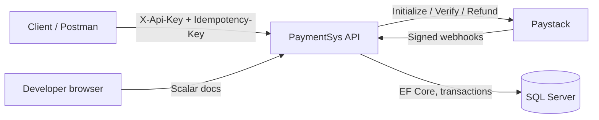
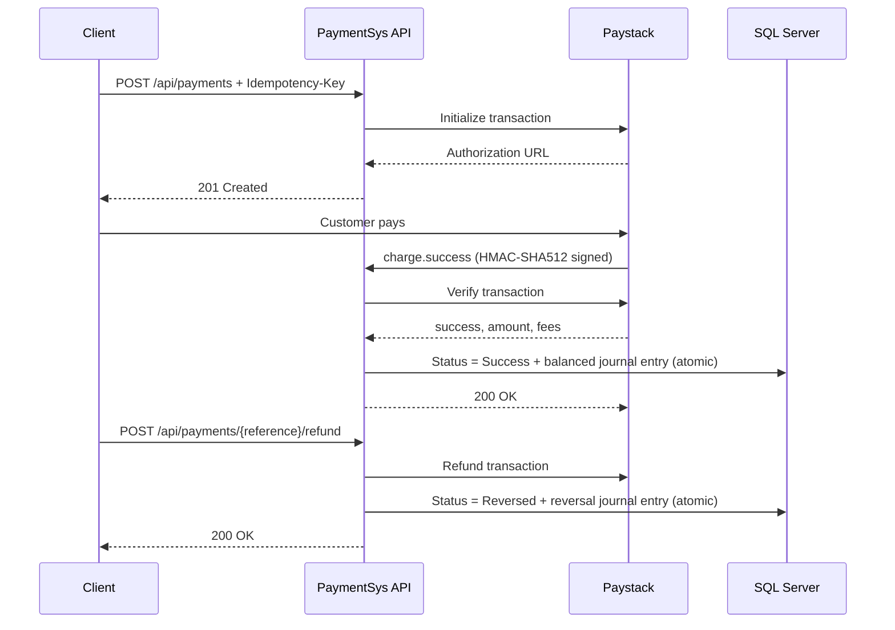

# PaymentSys

[](https://github.com/geep97/paymentsys/actions/workflows/ci.yml)

A GHS payment API built on Paystack, designed around the failure modes that break payment integrations: retried requests, duplicate webhooks, mismatched amounts, partial fees, and refunds that have to undo the books.

Typical payment integrations stop at "redirect to the gateway and update a status column." PaymentSys treats money as a double-entry ledger, enforces invariants in the database, and makes every write observable and replay-safe.

- Stack: ASP.NET Core `net10.0`, EF Core 10, SQL Server, Paystack
- API docs: `/scalar/v1` (Scalar UI over OpenAPI)
- Health check: `/health`
- Tests: 43 (unit + HTTP integration)

## Design principles

- **Money is posted, not just marked as paid.** Every successful charge creates a balanced journal entry with separate settlement, revenue, and processing-fee lines.
- **The database enforces the rules.** SQL Server triggers reject unbalanced entries and block updates/deletes on posted entries. Corrections happen through reversal entries, not edits.
- **Idempotency is mandatory on money-moving POSTs.** Duplicate requests replay the original response; different payloads return 422; concurrent requests return 409; keys are scoped per merchant and cleaned up over time.
- **Webhooks are treated as untrusted input.** Every request is HMAC-SHA512 verified with constant-time comparison, deduplicated by event ID, and logged with processing attempts and errors.
- **Status changes are guarded by a state machine.** `Pending -> Success | Failed | Reversed`, `Success -> Reversed`; illegal transitions are rejected and logged.
- **Payment details are verified.** Amount and currency returned by Paystack must match the stored transaction before anything is posted.
- **Refunds reverse the ledger.** A refund calls Paystack and then posts an idempotent reversal entry (`REV-{reference}`).
- **The whole system is tested.** 43 tests cover the ledger, idempotency, signature verification, refunds, and the HTTP surface (401/400/201/replay/webhook).

## Architecture



### Payment lifecycle



### Ledger example

A GHS 15.00 payment with a GHS 1.00 processing fee posts:

| Account | Debit (pesewas) | Credit (pesewas) |
| --- | ---: | ---: |
| `1000` Settlement (asset) | 1,400 | |
| `5000` Payment Processing Fees (expense) | 100 | |
| `4000` Revenue | | 1,500 |

All amounts are integer pesewas. The entry must balance before it can be posted, and posted entries are immutable.

## API

Base route: `/api/payments`. All payment endpoints require `X-Api-Key: <Merchant:ApiKey>`.
Money-moving POSTs also require `Idempotency-Key`.

| Method | Path | Description |
| --- | --- | --- |
| `POST` | `/api/payments` | Initiate a payment. Requires `Idempotency-Key`. Returns `201` with the reference and authorization URL. |
| `GET` | `/api/payments/{reference}` | Get a payment. |
| `POST` | `/api/payments/{reference}/verify` | Verify with Paystack, update status, post the ledger entry. |
| `POST` | `/api/payments/{reference}/refund` | Refund a successful payment and reverse its ledger entry. Requires `Idempotency-Key`. |
| `POST` | `/api/webhooks/paystack` | Paystack webhook receiver (no API key; HMAC signature required). |
| `GET` | `/health` | API and database health. |
| `GET` | `/scalar/v1` | Interactive API documentation. |

Initiate request:

```json
{
  "email": "buyer@example.com",
  "amountPesewas": 1500
}
```

Refund request:

```json
{
  "merchantNote": "Customer request"
}
```

### Idempotency behavior

| Situation | Result |
| --- | --- |
| Missing `Idempotency-Key` | `400 Bad Request` |
| First request | Processed, response stored |
| Same key + same body | Stored response replayed |
| Same key + different body | `422 Unprocessable Entity` |
| Same key while still processing | `409 Conflict` |
| Stale in-progress request (default 5 min) | Recovered and reprocessed |
| Expired record (default 24 h) | Removed and treated as new |

Keys are scoped per authenticated merchant, so two clients cannot collide. A background service removes expired idempotency records and processed webhook logs older than the retention window.

### Webhooks

- Signature: HMAC-SHA512 over the raw body, compared with fixed-time equality.
- Duplicate detection: unique `Provider + EventId` (`{event}:{data.id}`), with a unique-index race handled gracefully.
- Supported events: `charge.success` (verify and post), `refund.processed` (mark reversed).
- Every received event is stored with its payload, processing attempts, and error message. Non-supported events are logged and acknowledged.

A Postman collection with environment variables and a signed-webhook request is included at [`docs/PaymentSys.postman_collection.json`](docs/PaymentSys.postman_collection.json).

## Quick start

Prerequisites: .NET 10 SDK, SQL Server LocalDB, a Paystack account.

```powershell
dotnet restore
dotnet user-secrets set "Paystack:SecretKey" "<test-or-live-secret>" --project PaymentSys
dotnet user-secrets set "Merchant:ApiKey" "<generate-a-strong-key>" --project PaymentSys
dotnet run --project PaymentSys
```

Then open `http://localhost:5000/scalar/v1` (or the URL printed by Kestrel) and `http://localhost:5000/health`.

On startup in Development the app applies EF migrations and seeds the ledger accounts (`1000`, `4000`, `5000`).

## Configuration

Production values belong in environment variables, never in source or appsettings.

| Setting | Environment variable | Purpose |
| --- | --- | --- |
| Connection string | `ConnectionStrings__DefaultConnection` | SQL Server connection |
| Paystack secret | `Paystack__SecretKey` | API calls and webhook signature verification |
| Merchant API key | `Merchant__ApiKey` | `X-Api-Key` authentication |
| Merchant client ID | `Merchant__ClientId` | Idempotency and rate-limit partition |
| Paystack callback | `Paystack__CallbackUrl` | Checkout return URL |
| Rate limit | `RateLimit__PermitLimit`, `RateLimit__WindowSeconds` | Requests per window per client |
| CORS | `Cors__AllowedOrigins__0` | Allowed browser origins |
| Idempotency | `Idempotency__InProgressTimeoutMinutes`, `Idempotency__WebhookRetentionDays` | Recovery and retention |
| Ledger accounts | `Ledger__SettlementAccountNumber`, `Ledger__RevenueAccountNumber` | Account mapping |

## Tests

```powershell
dotnet test
```

Coverage includes:

- Atomic status + ledger posting, fees, reversal, and illegal transitions.
- Idempotency replay, payload mismatch, in-progress conflict, stale recovery, and client scoping.
- Webhook signature validation and retention cleanup.
- HTTP integration tests with `WebApplicationFactory`: auth 401, idempotency 400/201/replay, signed webhooks, duplicate delivery, and refund flow.

The integration suite uses EF Core InMemory and a fake Paystack client, so it runs without a database or network access.

## Deploying

1. Set `ASPNETCORE_ENVIRONMENT=Production` and configure the environment variables above.
2. Apply migrations as part of deployment: `dotnet ef database update --project PaymentSys`.
3. Ensure the app is reachable over HTTPS so Paystack can deliver webhooks.
4. Point the Paystack webhook URL at `https://<host>/api/webhooks/paystack`.
5. Use Paystack **test** keys outside production. Keep the live secret key and merchant API key server-side only, and expect real money movement in live mode.

The API docs and health endpoint are public by default. Put them behind authentication (or remove `MapOpenApi`/`MapScalarApiReference`) if the API should not be discoverable.

## Project layout

```text
PaymentSys/
  Authentication/        API key authentication handler
  BackgroundServices/    Retention cleanup
  Contracts/             Request/response and webhook DTOs
  Controllers/           Payments and Paystack webhook endpoints
  Data/                  DbContext, EF configurations, migrations, seeding
  Middleware/            Idempotency and exception handling
  Models/                Entities and enums
  Options/               Strongly typed configuration
  Services/              Ledger, payments, Paystack, idempotency
PaymentSys.Tests/        Unit and HTTP integration tests
```

## Known limitations

- Single merchant API key; no multi-tenant accounts, roles, or key rotation yet.
- Full refunds only (the Paystack model accepts an amount, but the service currently refunds the full transaction).
- Rate limiting is in-memory per instance; a multi-instance deployment needs a distributed limiter (for example Redis).
- No settlement reconciliation against Paystack reports, no automated chargeback workflow, and no metrics/tracing yet.
- Webhook processing is synchronous; Paystack retries are the recovery mechanism, and failures are recorded for inspection.
